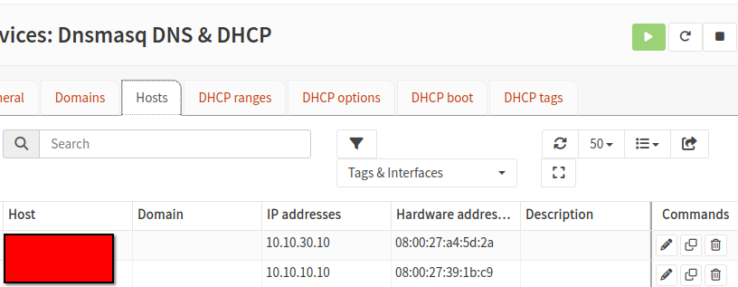

## Addressing Convention

| **Range** | **Use**                                                  |
| --------- | -------------------------------------------------------- |
| .1-.99    | Static addresses and reservations (servers, admin hosts) |
| .100-.200 | DHCP range                                               |
| .201-.253 | Spare                                                    |
| .254      | Gateway (OPNsense)                                       |

### Address Table

| **Segment** | **Network/CIDR** | **Gateway IP (OPNsense)** | **DHCP Range**              |
| ----------- | :--------------- | ------------------------- | --------------------------- |
| Servers     | 10.10.10.0/24    | 10.10.10.254              | 10.10.10.100-10.10.10.200   |
| Users       | 10.10.20.0/24    | 10.10.20.254              | 10.10.20.100-10.10.20.200   |
| Management  | 10.10.30.0/24    | 10.10.30.254              | 10.10.30.100-10.10.30.200   |
| Guests      | 10.10.40.0/24    | 10.10.40.254              | 10.10.40.100-10.10.40.200   |

### Reserved Address Table

* *The static IPs are assigned via Dnsmasq reservation*

| **Host**      | **Segment** | **IP Address** |
| ------------- | ----------- | -------------- |
| Lab Server    | Servers     | 10.10.10.10    |
| Admin Machine | Management  | 10.10.30.10    |

* For specific configurations see [OPNsense](/Docs/Implementation/OPNsense.md)