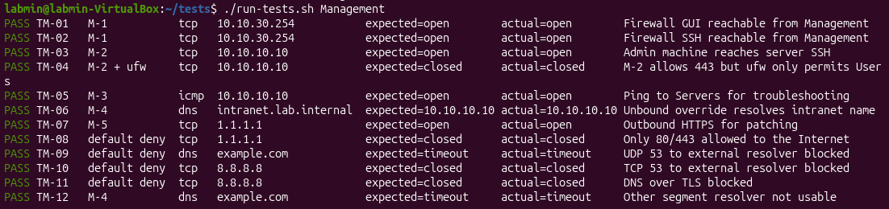
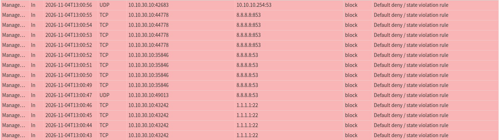
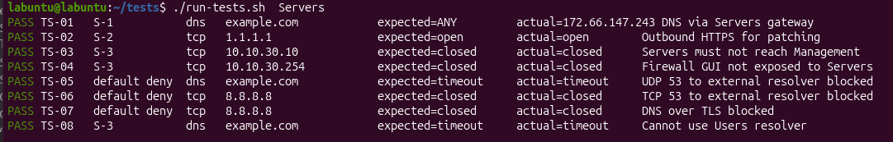
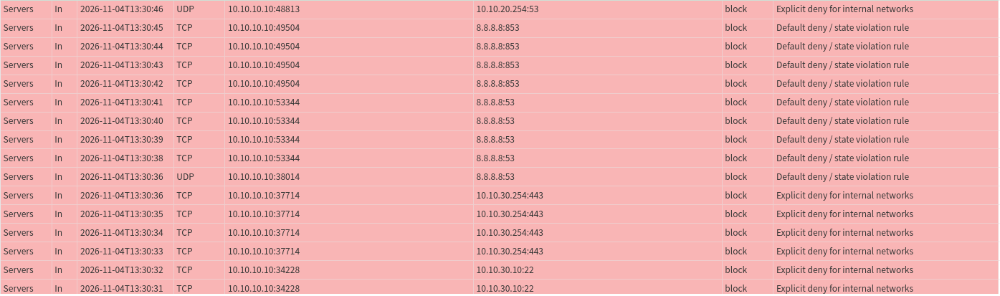
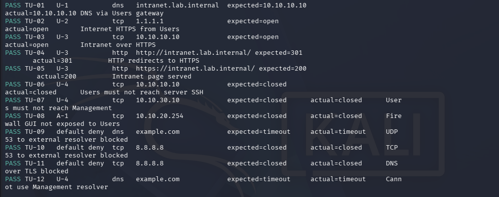
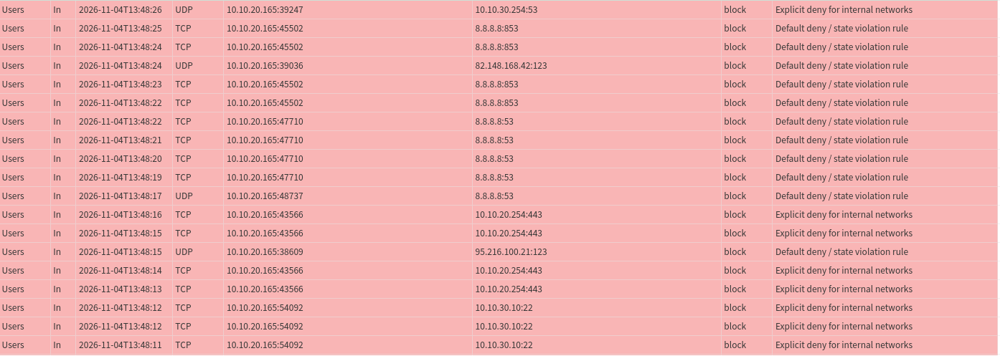
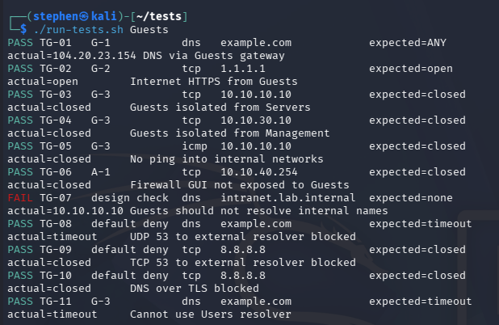

## Overview

Testing was conducted by running the `run-tests.sh` script on a host in each network segment, and by manually reviewing the firewall logs for the generated traffic. For further details about the script see [run-tests](/Docs/Validation/Scripts/run-tests-script.sh).

* *For testing in the Users segment a Kali Linux hosts was temporarily moved to the segment.*
* *For testing in the Guests segment, a Kali Linux host was added to the segment.*

| **Segment** | **Host used for testing**                        |
| ----------- | ------------------------------------------------ |
| Management  | Admin Machine                                    |
| Servers     | Lab Server (Accessed via SSH from Admin Machine) |
| Users       | Kali Linux                                       |
| Guests      | Kali Linux                                       |

---

## Management Segment

**Test Results:**

**OPNsense firewall log entries for denied traffic:**

---
## Servers Segment

**Test Results:**

**OPNsense firewall log entries for denied traffic:**

---
## Users Segment

**Test Results:**

**OPNsense firewall log entries for denied traffic:**

---
## Guests Segment

**Initial Test Run:**

