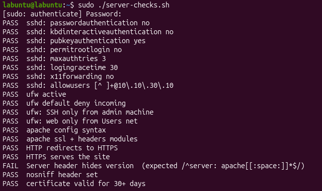
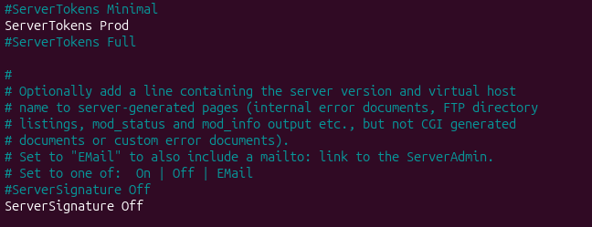
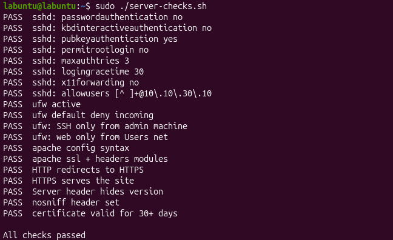

## Overview

The server configurations were checked with a combination of automated testing and manual verification. Automated testing was conducted with the `server-checks.sh` script. For further details about the script, see [server-checks](/Scripts/server-checks-script.sh).

---
## Initial Checks



* During the first round of checks, Apache was still revealing it's version in the server header and footer. This was also confirmed by a manual check:

```Shell
curl -si intranet.lab.internal

HTTP/1.1 301 Moved Permanently
Date: Fri, 06 Nov 2026 10:19:54 GMT
Server: Apache/2.4.66 (Ubuntu)
Location: https://intranet.lab.internal/
Content-Length: 365
Content-Type: text/html; charset=iso-8859-1

<!DOCTYPE HTML PUBLIC "-//W3C//DTD HTML 4.01//EN" "http://www.w3.org/TR/html4/strict.dtd">
<html><head>
<title>301 Moved Permanently</title>
</head><body>
<h1>Moved Permanently</h1>
<p>The document has moved <a href="https://intranet.lab.internal/">here</a>.</p>
<hr>
<address>Apache/2.4.66 (Ubuntu) Server at intranet.lab.internal Port 80</address>
</body></html>

```

* The configurations in `/etc/apache2/conf-available/security.conf` are correct and in place: 



* This most likely means that Apache hadn't re-read its configuration after the changes had been made. I reran the config test and reloaded Apache

```Shell
sudo apache2ctl configtest
sudo systemctl reload apache2
```

The changes are now applied successfully: 

```Shell
curl -si intranet.lab.internal

HTTP/1.1 301 Moved Permanently
Date: Fri, 06 Nov 2026 10:56:45 GMT
Server: Apache
Location: https://intranet.lab.internal/
Content-Length: 278
Content-Type: text/html; charset=iso-8859-1

<!DOCTYPE HTML PUBLIC "-//W3C//DTD HTML 4.01//EN" "http://www.w3.org/TR/html4/strict.dtd">
<html><head>
<title>301 Moved Permanently</title>
</head><body>
<h1>Moved Permanently</h1>
<p>The document has moved <a href="https://intranet.lab.internal/">here</a>.</p>
</body></html>
```

---
## Successful Check Run

